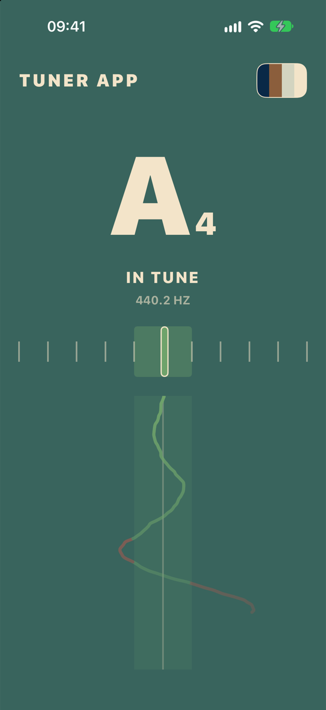
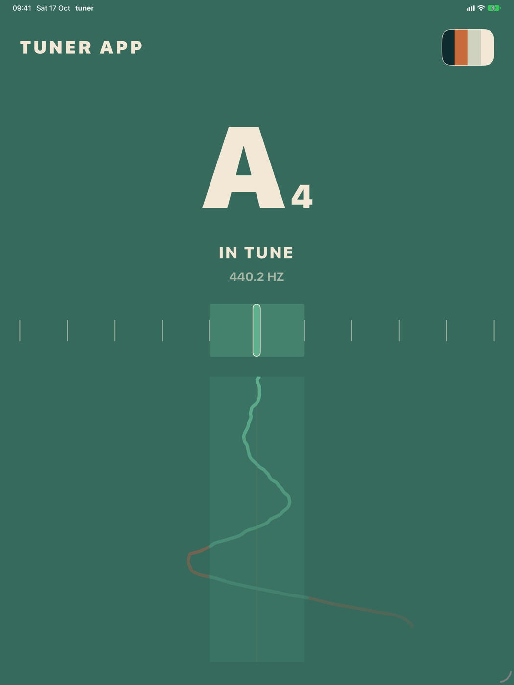
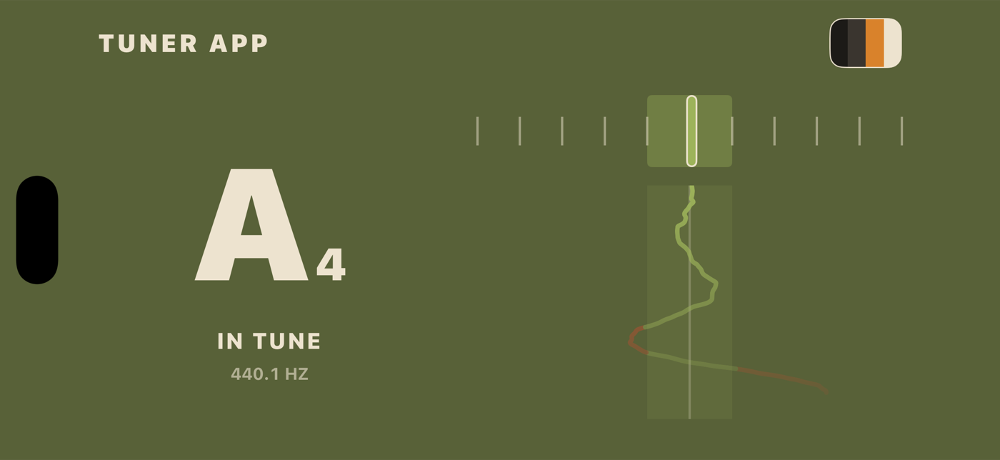

  

# Tuner

A free, one-screen chromatic tuner for iPhone and iPad. No ads, no accounts, no settings pages: play a note and it tells you what it is and how far off you are.

  
  &nbsp;
  

  

## Features

- **Any note, any instrument.** It hears every note from a piano's lowest A to its highest C and names it with its octave, e.g. **A4**.
- **Accurate to about a cent** from low E (E2) up to C7, which covers guitar, bass, voice and almost every orchestral instrument.
- **The whole screen lights up**: green when you're in tune (within 10 cents), red when you're flat or sharp. Each palette has its own green and red.
- **A cents meter** from 50 cents flat to 50 cents sharp, with the in-tune zone marked.
- **A pitch trail** draws the last six seconds of your note down the screen: flat to the left, sharp to the right. You can see a note drift, wobble or settle. The trail is eased so it flows; the note and meter above it show the exact reading.
- **Eight colour palettes**, the same ones as the Metronome app, cycled from the button in the top right. Your choice is remembered.
- **Listens only while it's on screen**, and picks up again after a phone call.
- **Portrait and landscape**, scaled up properly on iPad.

## Running it

You'll need Xcode with the iOS 27 SDK. The app targets iOS 27.

1. Open `tuner.xcodeproj`.
2. Pick an iPhone or iPad (a Simulator or a connected device) from the device menu.
3. Press **⌘R**, and allow microphone access when asked.

To run on your own device, choose your Apple ID under *Signing & Capabilities*, and turn on Developer Mode on the device. There are no dependencies to install.

A real device is the best way to try it: the Simulator listens through your Mac's microphone, which is fine for singing or playing nearby but won't hear sound from the Mac's own speakers.

## How it works

The microphone is read in overlapping windows of 4,096 samples, about 23 times a second. Each window goes through the [YIN algorithm](http://audition.ens.fr/adc/pdf/2002_JASA_YIN.pdf), which finds the pitch by looking for how often the waveform repeats. Unlike picking the loudest frequency, it isn't fooled by overtones, so a guitar's low E reads as E2, not its octave.

The frequency is turned into a note with `69 + 12 × log₂(f / 440)`: the nearest whole number is the note, and what's left over × 100 is how many cents sharp or flat it is. A median of the last few readings keeps the display steady without making it slow.

## Project layout

| File | What it does |
|---|---|
| `Pitch.swift` | The YIN pitch detector, and turning a frequency into a note and cents |
| `Tuner.swift` | Listens to the microphone, smooths the readings and keeps the recent history for the trail |
| `ContentView.swift` | The single screen and its layout for portrait, landscape and iPad; the cents meter |
| `PitchTrail.swift` | The pitch trail |
| `Palette.swift` | The colour palettes, including each one's in-tune green and off-pitch red |
| `Controls.swift` | The instant-response button |
| `tools/make-icon.swift` | Draws the app icon: `swift tools/make-icon.swift tuner/Assets.xcassets/AppIcon.appiconset` |
